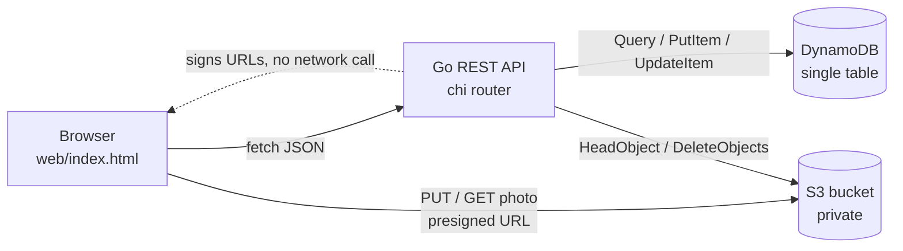
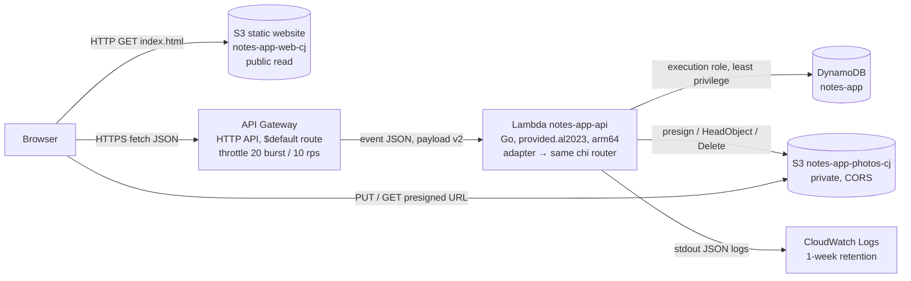

# Notes App: Go + AWS (DynamoDB, S3, Lambda)

A small notes app built to get hands-on with cloud backend engineering: a **Go REST API** with **DynamoDB** for data and **S3** for photos, uploaded directly from the browser with **presigned URLs**. It runs fully locally in **Docker**, and the same code is **deployed on AWS**: Lambda + API Gateway for the API, an S3 static website for the frontend.

Create folders, write notes inside them, and attach photos to each note.

## Architecture



**Photo upload flow:** the API never touches the image bytes.
1. The browser asks the API for an upload URL (`POST .../photo-url`, with content type and size).
2. The API returns a **presigned PUT URL**, valid for 5 minutes and signed for that exact type and size.
3. The browser uploads straight to S3. A different type or size → S3 rejects it (`403 SignatureDoesNotMatch`).
4. The browser confirms (`POST .../photos`). The API checks the object exists, then saves its key on the note.
5. Listing notes returns short-lived **presigned GET URLs** for the thumbnails. The bucket stays private.

### Deployed on AWS (us-east-2)


- **Two entry points, one codebase:** `cmd/server` (ListenAndServe: local/Docker) and `cmd/lambda` (API Gateway event → `http.Request` via `aws-lambda-go-api-proxy`). Both call `internal/app.NewHandler`, so routing, handlers and data code are identical everywhere.
- **IAM:** the Lambda's execution role allows only the needed DynamoDB actions on one table, S3 actions on `notes/*`, and its own log group. A resource-based policy lets only this API (`aws:SourceArn`) invoke the function.
- **CORS:** handled once, in Go middleware. API Gateway passes `OPTIONS` through; the photo bucket has its own CORS rule.
- Resources were created in the AWS Console (for learning). `infra/create-resources.sh <step>` verifies each one; policies live in `infra/iam/`.

## Tech stack
| Layer | Tech |
|---|---|
| API | Go 1.27, [chi](https://github.com/go-chi/chi), AWS SDK for Go v2, structured JSON logs (`log/slog`) |
| Data | DynamoDB, single-table design, on-demand |
| Files | S3 (private) + presigned URLs |
| Frontend | One static `index.html`, vanilla JS, no build step, light/dark |
| Local dev | Docker Compose: API + DynamoDB Local + LocalStack (S3) |
| Container | Multi-stage build → distroless, non-root, ~23 MB |
| Cloud | Lambda (Go, arm64), API Gateway HTTP API, S3 static website, IAM least privilege, CloudWatch Logs |
| Next | CodePipeline/CodeBuild (CI/CD), CloudWatch alarms + Logs Insights |

## Data model (single table `notes-app`)
| Item | PK | SK | Attributes |
|---|---|---|---|
| Folder | `USER#demo` | `FOLDER#<id>` | name, createdAt |
| Note | `FOLDER#<folderId>` | `NOTE#<id>` | title, text, photoKeys, createdAt, updatedAt |

Every read is a single `Query` on one partition (`begins_with(SK, "FOLDER#")` / `"NOTE#"`), never a `Scan`.

## REST API
| Method | Path | Result |
|---|---|---|
| GET | `/health` | 200 |
| POST | `/folders` | 201: create `{name}` |
| GET | `/folders` | 200: list |
| DELETE | `/folders/{folderId}` | 204: deletes its notes and photos too |
| POST | `/folders/{folderId}/notes` | 201: create `{title, text}` |
| GET | `/folders/{folderId}/notes` | 200: list, with presigned photo URLs |
| PUT | `/folders/{folderId}/notes/{noteId}` | 200: update `{title, text}` |
| DELETE | `/folders/{folderId}/notes/{noteId}` | 204: deletes its photos too |
| POST | `/folders/{folderId}/notes/{noteId}/photo-url` | 200: `{uploadUrl, key}` for `{contentType, size}` |
| POST | `/folders/{folderId}/notes/{noteId}/photos` | 200: confirm upload `{key}` |

Errors are JSON `{"error": "..."}`: 400 for bad input, 404 for missing resources, and 500 for server faults (logged with a request ID).

## Run it locally
Prereqs: Docker Desktop, and a free [LocalStack](https://localstack.cloud) auth token (their image needs one).

```bash
echo 'LOCALSTACK_AUTH_TOKEN=<your-token>' > .env   # never committed (.gitignore)
docker compose up -d --build                        # API :8080, DynamoDB Local :8000, LocalStack S3 :4566
cd web && python3 -m http.server 5500               # frontend → http://localhost:5500
```

Tests (end-to-end, against any base URL):
```bash
scripts/smoke.sh        # 13 checks: folders + notes CRUD, validation, 404s
scripts/photo-test.sh   # presigned upload/download, signature enforcement, type/size limits, S3 cleanup
```

Run the API without Docker (needs the two emulators running):
```bash
DYNAMODB_ENDPOINT=http://localhost:8000 S3_ENDPOINT=http://localhost:4566 go run ./cmd/server
```

## Project structure
```
cmd/server/          entry point 1: HTTP server (local, Docker)
cmd/lambda/          entry point 2: AWS Lambda (API Gateway v2 events)
internal/app/        shared wiring: config, AWS clients, router
internal/api/        router, handlers, middleware (request logging, CORS)
internal/store/      DynamoDB access (single-table)
internal/photos/     S3 presigned URLs, existence check, batch delete
web/index.html       the whole frontend
infra/               create-resources.sh (verify/create AWS resources), iam/ policies, LocalStack init
scripts/             smoke/photo tests (BASE_URL=local or API Gateway), build-lambda.sh
Study-Notes-Interview/   my learning notes per topic (AWS, Docker, Go, CORS, REST...)
```

## Design decisions
- **Presigned URLs:** photo bytes go browser ↔ S3 directly. The API stays small and fast (no Lambda payload limits), and the bucket stays private.
- **Single-table DynamoDB:** keys are designed around the two access patterns, so each list is one Query.
- **Conditional writes:** updating a missing note returns 404 instead of silently creating it (`attribute_exists(PK)`).
- **Config through env vars:** the same binary runs against local emulators or real AWS with no code change.
- **Least-privilege containers:** a distroless, non-root image with no shell.
- **Explicit CORS origin** instead of `*`. The bucket has its own CORS rule for browser uploads.

## Known gaps (deliberate, for now)
- **No auth:** a single demo user. Next step: Cognito, or a JWT authorizer on API Gateway.
- **No pagination:** would use `LastEvaluatedKey`.
- **Frontend over HTTP:** the S3 website endpoint has no HTTPS. Next: CloudFront + private bucket (OAC).
- **Text needs Save, photos save on upload:** would autosave text with a debounce.
- **Orphaned uploads** (uploaded but never confirmed): would add an S3 lifecycle rule or a sweeper job.

## Roadmap
- [x] Local API (folders and notes CRUD on DynamoDB Local)
- [x] Photos via presigned S3 URLs
- [x] Docker (multi-stage, distroless, compose)
- [x] Frontend
- [x] Deploy: Lambda + API Gateway + S3 static site, least-privilege IAM
- [ ] CI/CD: GitHub → CodePipeline → CodeBuild
- [ ] Observability: CloudWatch Logs Insights, 5xx alarm
- [ ] Stretch: Kubernetes (kind) manifests with probes, ECS Fargate
