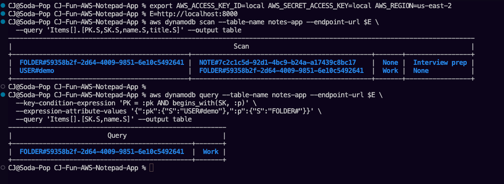

# DynamoDB

## Core ideas
- **Partition key (PK):** DynamoDB hashes it to choose a physical partition. All items with the same PK are stored together.
- **Sort key (SK):** orders items within a partition. It enables range queries such as `begins_with`, `between`, and `>`.
- **Query vs Scan:** `Query` reads one partition by key (cheap and fast). `Scan` reads the whole table (expensive). Design keys so you only need Query.
- **On-demand vs provisioned:** On-demand bills per request with no capacity planning, which is great for spiky or low traffic. Provisioned is cheaper at steady, predictable load.
- **Table class: Standard vs Standard-IA (Infrequent Access):** Standard-IA has ~60% cheaper **storage** per GB but ~25% pricier **reads/writes**. It pays off only for big tables that are rarely read (old logs, archives). Small, actively used tables (ours) → **Standard**. Switching later is allowed.
- **Writes are upserts:** `PutItem` overwrites an existing item. Use `ConditionExpression` to enforce "must exist" or "must not exist."

## In this project
| Item   | PK                  | SK            |
|--------|---------------------|---------------|
| Folder | `USER#demo`         | `FOLDER#<id>` |
| Note   | `FOLDER#<folderId>` | `NOTE#<id>`   |
- List folders: `Query PK=USER#demo AND begins_with(SK,"FOLDER#")`
- Update a note: `UpdateItem ... ConditionExpression attribute_exists(PK)`, which returns 404 if the note is missing.
- Delete a note: `DeleteItem ReturnValues=ALL_OLD`, which lets us learn the note's photo keys for S3 cleanup in one call.

## Worked example: what the table actually holds
Two folders (Work, Personal), with 2 notes in Work and 1 in Personal. IDs are shortened; real ones are UUIDs.

| PK | SK | name | title | text | photoKeys |
|----|----|------|-------|------|-----------|
| `USER#demo` | `FOLDER#f1` | Work | | | |
| `USER#demo` | `FOLDER#f2` | Personal | | | |
| `FOLDER#f1` | `NOTE#n1` | | Interview prep | Study IAM | `[]` |
| `FOLDER#f1` | `NOTE#n2` | | Standup | Blocked on S3 | `[]` |
| `FOLDER#f2` | `NOTE#n3` | | Groceries | milk, eggs | `["notes/n3/a.jpg"]` |

- It's **one table** holding two kinds of rows. Columns are optional per item: folders have `name`, notes have `title/text`.
- DynamoDB physically groups rows by PK (it's a "partition" of related items):
  - `USER#demo` → [FOLDER#f1, FOLDER#f2]
  - `FOLDER#f1` → [NOTE#n1, NOTE#n2]
  - `FOLDER#f2` → [NOTE#n3]

### The 4 reads/writes we do, and their SQL equivalents
| App action | DynamoDB call | Rough SQL equivalent |
|---|---|---|
| List folders | `Query PK="USER#demo" AND begins_with(SK,"FOLDER#")` | `SELECT * FROM t WHERE PK='USER#demo' AND SK LIKE 'FOLDER#%'` |
| List notes in Work | `Query PK="FOLDER#f1" AND begins_with(SK,"NOTE#")` | `... WHERE PK='FOLDER#f1' AND SK LIKE 'NOTE#%'` |
| Get one note | `GetItem PK="FOLDER#f1", SK="NOTE#n1"` | `... WHERE PK=... AND SK=...` (exact key) |
| Delete folder f1 | Query its notes, `DeleteItem` each, then `DeleteItem` the folder row | No `ON DELETE CASCADE`; we do it ourselves |

- **Why the `FOLDER#` / `NOTE#` prefixes?** They make keys self-describing, and they let one partition hold several item types later. For example, `USER#demo / PROFILE` could sit next to the folders, and `begins_with` picks only the type you want.
- **Rule:** a Query must give an exact PK. You can't say "all notes everywhere" without a Scan or a GSI. That's the tradeoff for constant-speed lookups at any scale.

### Look at it yourself (DynamoDB Local)
```bash
# The CLI insists on credentials even for local. Dummies are fine (this terminal only).
export AWS_ACCESS_KEY_ID=local AWS_SECRET_ACCESS_KEY=local AWS_REGION=us-east-2
E=http://localhost:8000

aws dynamodb list-tables --endpoint-url $E
# Every row (Scan = read the whole table; OK locally, avoid in prod)
aws dynamodb scan --table-name notes-app --endpoint-url $E \
  --query 'Items[].[PK.S,SK.S,name.S,title.S]' --output table
# List folders: the exact Query our Go code runs
aws dynamodb query --table-name notes-app --endpoint-url $E \
  --key-condition-expression 'PK = :pk AND begins_with(SK, :p)' \
  --expression-attribute-values '{":pk":{"S":"USER#demo"},":p":{"S":"FOLDER#"}}' \
  --query 'Items[].[SK.S,name.S]' --output table
```
### My real run (2026-11-14)
I created a folder and a note through the API:
```bash
curl -s -X POST localhost:8080/folders -H 'Content-Type: application/json' -d '{"name":"Work"}'
# → {"id":"59358b2f-...","name":"Work","createdAt":"2026-11-14T20:28:05Z"}
curl -s -X POST localhost:8080/folders/59358b2f-.../notes -H 'Content-Type: application/json' \
  -d '{"title":"Interview prep","text":"Study IAM"}'
# → {"id":"7c2c1c5d-...","folderId":"59358b2f-...","title":"Interview prep","text":"Study IAM","photoKeys":[],...}
```
Then I looked inside DynamoDB Local with the CLI:



What the screenshot shows:
- **Scan** returned both rows: the folder (`PK=USER#demo`) and the note (`PK=FOLDER#59358b2f...`). The note's PK is the folder's ID, which is how a note "belongs to" a folder.
- `None` means the attribute doesn't exist on that item. Folders have no `title`, and notes have no `name`. That's normal in NoSQL.
- **Scan order is not sorted.** DynamoDB orders by the hash of the PK, which is why the note row came first.
- **Query** only returned the folder, because it only read the `USER#demo` partition.

- `{"S": "..."}` is DynamoDB's typed JSON: S = string, N = number, L = list, M = map. The Go SDK's `attributevalue` package converts between Go structs and this format.

## Interview one-liners
- "I used single-table design: I modeled keys around access patterns, so every read is a single Query, never a Scan."
- "Hot partitions happen when one PK gets too much traffic. Spread load with high-cardinality keys."
- "Pagination: Query returns at most 1 MB per page. You continue with `LastEvaluatedKey` → `ExclusiveStartKey`."
- "Need another access pattern? Add a GSI (a global secondary index with a different PK/SK)."
