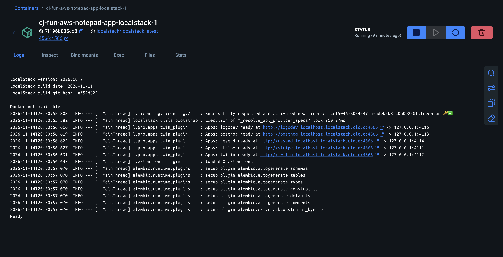
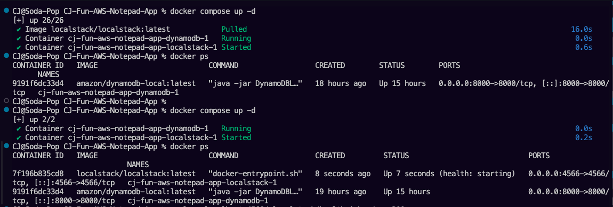

# LocalStack

## What it is
- A Docker container that **emulates AWS APIs on your laptop**, all on one port: **4566**. We use it only for **S3** (`SERVICES=s3` in `docker-compose.yml`).
- It plays the same role as DynamoDB Local: the same SDK and CLI calls work, you just point them at `--endpoint-url http://localhost:4566`.
- **Why use it:** it's free, fast, works offline, and you can't break or get billed on real AWS. **Limits:** it's an emulation. IAM policies are mostly not enforced and some edge cases differ, so you still test on real AWS before prod.

## Setup in this project (2026)
- Newer LocalStack images **require an auth token**. A free account (I signed up with Google) gives a "freemium" license.
- The token lives in **`.env`** (`LOCALSTACK_AUTH_TOKEN=...`). Docker Compose reads `.env` automatically, and `docker-compose.yml` passes it in as `${LOCALSTACK_AUTH_TOKEN:-}`. **Never commit `.env`**: it goes in `.gitignore`.
- `brew install localstack` installs an optional CLI. It isn't needed, because we run the container via compose. (During install, macOS asked for Keychain access for `git-credential-osxkeychain`. That's git fetching the brew "tap" from GitHub. It's safe to click **Deny**, since it's a public repo.)

## How I knew it was up

- `docker ps` → STATUS goes from `(health: starting)` to `(healthy)`.
- `curl -s localhost:4566/_localstack/health` → `"s3": "available"`. Every other service shows `disabled`.
- Logs: `license ... activated 🔑✅` (the token worked), and at the end, `Ready.`

### What the log lines mean
| Log line | Meaning |
|---|---|
| `Docker not available` | LocalStack can't reach the Docker engine *from inside its container*. It needs that only to run emulated Lambdas as containers. Irrelevant for S3. |
| `license ... freemium 🔑✅` | The auth token from `.env` was accepted. |
| `Apps: stripe / twilio / posthog / resend / logodev ready` | **"App twins"**: fake versions of popular *third-party* (non-AWS) APIs that ship with the licensed image and start automatically. `SERVICES=s3` limits only the **AWS** services. These sit idle and we don't use them. Same idea, applied to Stripe: test payments without hitting real Stripe. |
| `alembic ... setup plugin` | Internal database-migration tooling starting up. Ignore it. |
| `Ready.` | Ready to accept requests. |

## First-run gotcha

- The first `docker compose up -d` said `Started`, but `docker ps` showed only DynamoDB: **the container started and then exited** (the token wasn't set yet). The second `up`, after creating `.env`, stayed up.
- Debug loop: `docker ps -a` (shows exited containers) → `docker compose logs localstack` (why it died) → fix → `docker compose up -d`.

## Lesson: emulators skip security checks (I caught this)
- I uploaded a JPEG with `Content-Type: image/png` to a URL signed for `image/jpeg`, and **LocalStack returned 200**. Real S3 returns **403 SignatureDoesNotMatch**.
- Cause: by default, LocalStack **skips presigned-URL signature validation**. Fix in compose: `S3_SKIP_SIGNATURE_VALIDATION=0`.
- Then *every* upload got 403, including correct ones. The error body said `SignatureDoesNotMatch ... <AWSAccessKeyId>local`. LocalStack verifies signatures using the secret **`test`**, and our server was signing with the dummy secret `local`. Fix: the dummy creds must be **`test/test`** (LocalStack's convention).
- Debug habit: **read the full error body** (`curl -s ...` without `| head -1`). S3 errors are XML with a `<Code>` that names the exact problem.
- Takeaway: *emulators are for speed, not for proving security behavior. Verify on real AWS.*

## Init hooks: auto-create the bucket
- Scripts mounted into `/etc/localstack/init/ready.d/` run once LocalStack is ready. `infra/localstack-init.sh` runs `awslocal s3 mb s3://notes-app-photos`, so the bucket exists after every restart.
- `awslocal` = the aws CLI pre-pointed at LocalStack (it ships inside the container).
- LocalStack is in-memory: recreating the container wipes the photos, but DynamoDB still lists their keys. That's a **dangling reference** (the DB points at a file that's gone).

## Commands I used
```bash
export AWS_ACCESS_KEY_ID=test AWS_SECRET_ACCESS_KEY=test AWS_REGION=us-east-2   # LocalStack convention: test/test
aws s3 mb s3://notes-app-photos --endpoint-url http://localhost:4566             # make bucket
aws s3 ls --endpoint-url http://localhost:4566                                    # list buckets
aws s3 cp /tmp/test.txt s3://notes-app-photos/notes/demo/test.txt --endpoint-url http://localhost:4566
aws s3 ls s3://notes-app-photos --recursive --endpoint-url http://localhost:4566
# → 2026-11-14 13:05:14          6 notes/demo/test.txt
```

## Interview one-liner
- "For local dev, I ran DynamoDB Local and LocalStack in docker-compose and pointed the SDK at them with an endpoint override driven by env vars. Same code, no AWS cost, and real AWS only in the deployed environments."
