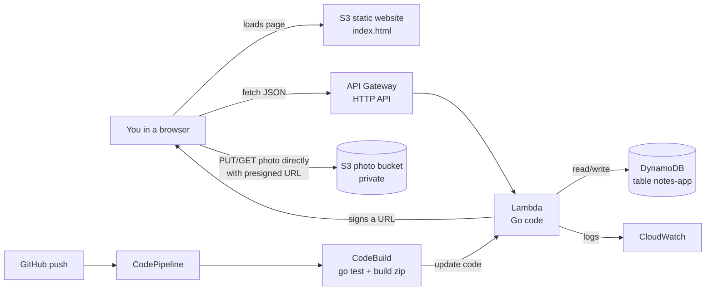
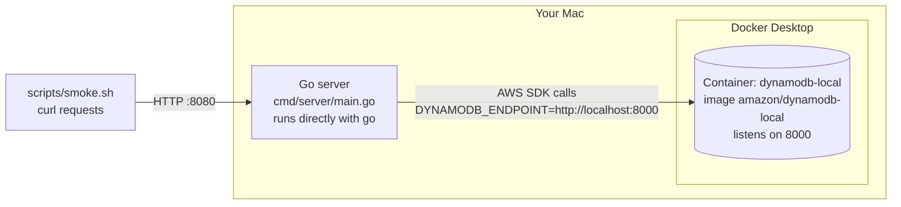
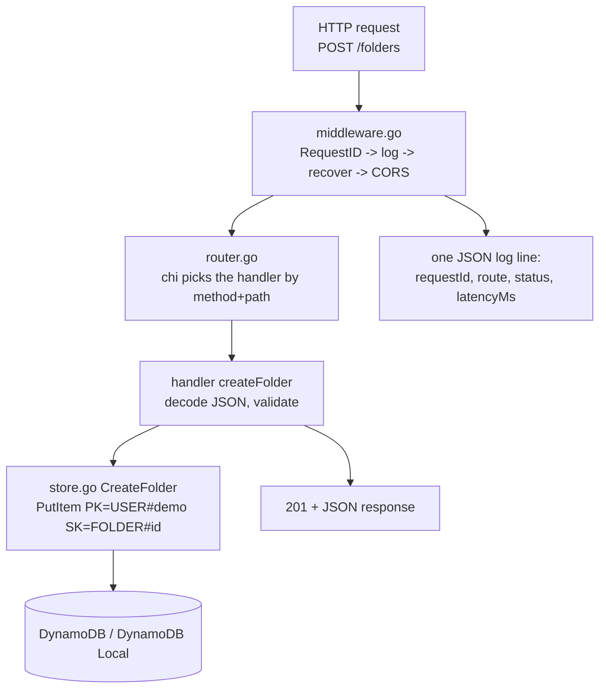
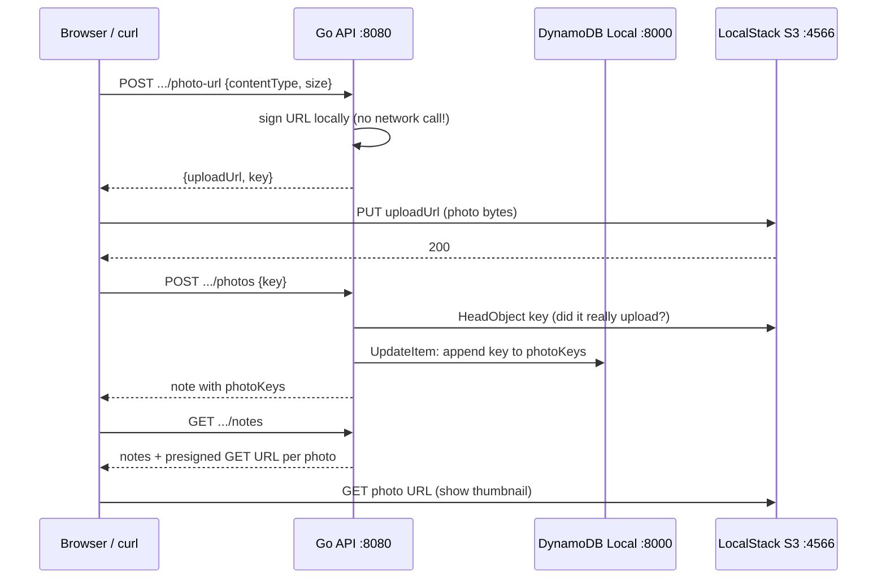
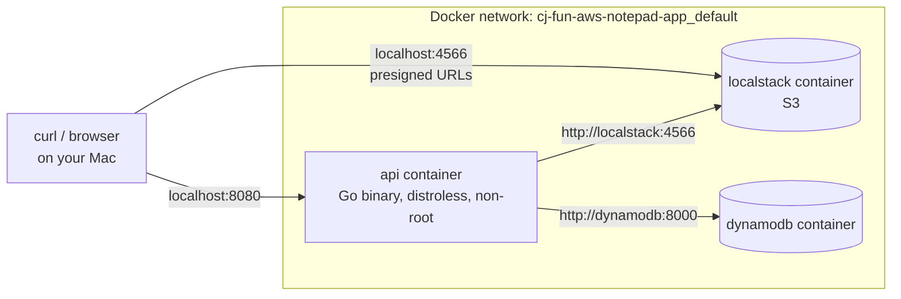

# Project Flow (living doc, updated each phase)

> Tip: the flowcharts use Mermaid. GitHub renders them directly. In VS Code, install the extension **"Markdown Preview Mermaid Support"**, then press `Cmd+Shift+V`.

## 1. The final target (what we're building toward)

## 2. Where we are now: Phase 1 (local only, nothing on AWS yet)

### How a single request flows through the code

## 3. Phase 2: photo upload (presigned URLs, LocalStack locally)

## 4. Phase 3: everything in Docker

## Phase log
| Phase | What changed in the flow |
|-------|--------------------------|
| 1 Local API | Go server on the Mac talks to DynamoDB Local in Docker on port 8000 |
| 2 Photos | + LocalStack (S3) on 4566. The API only *signs* URLs; photo bytes go browser ↔ S3 directly |
| 3 Docker | The API runs as a 3rd container. Containers talk by service name; the Mac uses published ports |
| 4 Frontend | `web/index.html` served on `:5500` calls the API `:8080` (CORS: Go middleware) and S3 `:4566` (CORS: bucket rule) |
